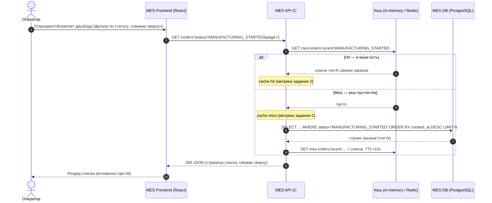
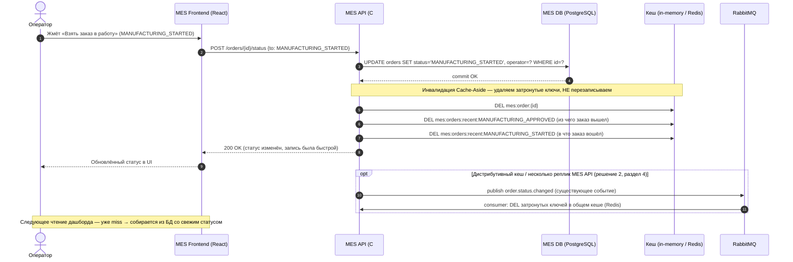

# Архитектурное решение по кешированию

**Статус:** черновик технического документа (draft)

**Автор:** Марат Гатин

**Область:** серверное кеширование в системе «Александрит» — в первую очередь список заказов MES (дашборд операторов) и карточка заказа

**Связь с другими заданиями:** решение реализует инициативу **I2 («Быстрый выигрыш: производительность дашборда MES»)** из задания 1 — конкретный инструмент «кэш свежих заказов». Кеширование **не заменяет** инициативы I1 (асинхронный конвейер расчёта стоимости), I3 (надёжность потока заказов) и I7 (масштабирование/HA) — оно снимает с MES DB именно **повторяющуюся read-нагрузку**. Метрики решения (hit-rate, p95 дашборда) идут в стек задания 2 (VictoriaMetrics/Grafana); `cache.hit/miss` — атрибуты span из задания 3.

---

## 1. Контекст: где именно MES тормозит

Задание дано на двух симптомах:

- **S4** — операторы: первая страница MES (список заказов в работе по статусам, «самые новые сверху») грузится долго. Фильтр по статусам и пагинация **не помогли**.
- **Новые клиенты** (B2C после роста рынков и B2B после открытия API) не устраивает **скорость выполнения заказа**.

Почему дашборд медленный — из C4-модели (`jewerly_c4_model.drawio`) и описания, проблемы P2/P3 из задания 1:

1. **Один инстанс MES DB** обслуживает и запись, и чтение. Таблица заказов растёт: +100 заказов/мес органики + всплеск B2B после открытия API во втором квартале.
2. **Запрос «список по статусу, новые сверху»** выполняется при каждом обновлении страницы: фильтрация + сортировка по крупной таблице (индексы под этот запрос — под вопросом, подтверждается slow-query профилированием, оно в том же I2).
3. **Тот же процесс MES API** одновременно: обслуживает дашборд, принимает внешний B2B-API и держит **долгие расчёты стоимости (2–30 минут)**, которые оккупируют пул потоков и соединения БД.
4. **Нагрузка повторяющаяся и идентичная.** 10 операторов, обновляющих список, — это 10 одинаковых дорогих запросов к одной и той же БД за те же данные. Между обновлениями данные почти не меняются: статус конкретного заказа меняется редко и дискретно (взял в работу → выполнил → упаковал → отправил).

**Ключевой профиль данных для кеширования** — все три условия выполнены:

| Свойство | У нас |
|---|---|
| Чтения >> записи | Список читается каждым оператором много раз в минуту; статус меняется дискретно, редко |
| «Горячие» данные малы | Операторам нужны **новые** заказы (топ-N по статусу), а не вся история тысяч закрытых заказов |
| Данные меняются дискретно, по событию | Событие смены статуса **уже существует**: MES/CRM обмениваются сообщениями статусов через RabbitMQ — его можно использовать для инвалидации |

Это классический профиль «read-heavy, slowly changing data» — тот случай, где кеш даёт максимум эффекта при минимуме сложности.

---

## 2. Мотивация

### 2.1. Почему предлагаем внедрить кеширование и какие проблемы оно должно решить

Кеширование здесь — не «оптимизация ради оптимизации», а прямой удар в причину S4: **повторяющаяся идентичная read-нагрузка на единственную БД**, которая одновременно обслуживает записи и долгие расчёты.

Проблемы, которые решает решение:

1. **Скорость загрузки дашборда MES (S4, боль операторов).** Вместо 10 дорогих запросов к БД при 10 обновлениях — один запрос (miss), остальные — hit из кеша. p95 дашборда: с «секунд/десятков секунд под нагрузкой» до сотен миллисекунд.
2. **Разгрузка MES DB от read-нагрузки.** БД освобождает CPU и пул соединений для write-пути: создание заказов, смена статусов, чтение для расчёта стоимости. Это **косвенный, но реальный** вклад в «скорость выполнения заказа» (боль клиентов): меньше contention между чтением дашборда и записью конвейера на одном инстансе.
3. **Операторы видят новые заказы мгновенно.** «Свежие сверху» — основа их вознаграждения (кто взял заказ, тот и получает оплату). Быстрый и свежий список → заказ быстрее берётся в работу → производственные мощности реально используются, а не простаивают из-за «не видного» заказа (логика I2 из задания 1).
4. **Запас на рост.** Поток заказов растёт +100/мес + B2B. Без кеша каждый прирост линейно (а по мере роста таблицы — и сверхлинейно) превращается в load на БД. Кеш **развязывает** нагрузку дашборда от нагрузки БД: дашборд может расти почти бесплатно, пока жив кеш.

**Почему именно сейчас:** это самый быстрый видимый результат в рамках I2 (1–2 спринта), который операторы почувствуют сразу, пока строятся более тяжёлые меры (индексы, read-реплика, конвейер расчёта I1). Быстрый выигрыш даёт доверие команды и бизнеса к архитектурному плану (задание 1, P0).

### 2.2. Какие элементы системы включаем в кеширование

| # | Элемент | Кешируем? | Уровень | Обоснование |
|---|---|---|---|---|
| **C1** | **Список заказов дашборда MES по статусу** («в работе», свежие сверху, топ-N) | **Да — главный объект** | Серверный | Read-heavy; строка меняется только при смене статуса; дорогой запрос; единая БД на read+write |
| **C2** | **Карточка заказа (order by ID)** — агрегат, который оператор видит по клику на строку | **Да** | Серверный | Сборка агрегата (статусы, оператор, факт цены, метаданные файла) дороже, чем одна строка; читается чаще, чем пишется; инвалидация по одному ключу |
| **C3** | **Рассчитанная стоимость** (memo по 3D-модели) | Частично (опция) | Серверный | Цена детерминирована моделью: повторная отправка той же модели не должна пересчитываться. Но большинство заказов уникальны — эффект маргинален; главный инструмент скорости — конвейер I1, не кеш |
| **C4** | **Каталог товаров** онлайн-магазина (Shop API) | Да — фаза 2 | Серверный / CDN | Read-heavy, меняется редко. Не текущая боль (боль — в MES), включаем после стабилизации C1/C2 |
| **C5** | **Путь создания заказа и смены статуса** (write-путь, B2C и B2B) | **Нет** | — | Записи не гоняем через кеш: нужна скорость, атомарность и БД как источник истины. Кеш записи только добавляет латентности и рисков (см. 3.2) |
| **C6** | Сессии/аутентификация во всех приложениях | Нет | — | По условию задачи проблем нет — исключаем из области |
| **C7** | 3D-файлы моделей | Нет | — | Крупные бинарники — это S3-хранилище (у него свой CDN/кэширование), не предмет нашего кеша |

**Итог фазы 1: C1 + C2 (дашборд MES и карточка заказа); C3 — опция внутри MES; C4 — фаза 2; C5/C6/C7 — сознательно вне кеша.**

### 2.3. Чего кеширование НЕ решит (границы, чтобы не завышать ожидания)

| Проблема | Решит ли кеширование | Что решает по-настоящему |
|---|---|---|
| Расчёт стоимости занимает 2–30 минут | **Нет.** Расчёт — CPU-работа, а не «чтение значения». Кеш не делает вычисление быстрее | Конвейер расчёта I1 (задание 1) |
| Заказы «теряются»/зависают (жалобы B2C и B2B) | **Нет.** Потеря сообщения в очереди не лечится кешем | Надёжность I3: идемпотентность, DLQ, сверка |
| Партнёры «не получают заказы» через API | **Нет.** Это приём/надёжность B2B-канала и обратная связь по статусам | B2B-фасад I4 (квоты, вебхуки, SLA) |
| «БД медленная в целом» (нет индексов под запросы) | **Частично.** Кеш снимает read дашборда, но write-путь и расчёт всё равно идут в БД | Оптимизация запросов/индексов + read-реплика (тоже часть I2) |
| Один EC2/инстанс на сервис (SPOF) | **Нет** | I7: масштабирование, HA |

**Важно для бизнеса:** кеширование — один из инструментов I2 (наряду с индексами и read-репликой), а не их замена. И он не ускоряет физическое изготовление/расчёт — он ускоряет **видимость и обработку** заказов людьми и системой.

### 2.4. Что это даст компании: метрики

| # | Метрика (тип) | Было (оценка) | Цель | Как измерить |
|---|---|---|---|---|
| **M1** | **p95/p99 загрузки дашборда MES** (техническая) | «Долго» по жалобам операторов: секунды, до десятков секунд под пиком/при конкурентных расчётах | **p95 < 500 мс**, p99 < 1 с (при hit — десятки мс) | Метрики эндпоинта `/orders` (OTel → VictoriaMetrics/Grafana, задание 2) |
| **M2** | **Hit-rate кеша по списку заказов** (техническая) | — | **> 90%** на горячих статусах | `cache.hits / (cache.hits + cache.misses)` по префиксу ключей |
| **M3** | **Доля load MES DB, занятая чтением дашборда** (техническая) | Высокая (дашборд + тяжёлый запрос) | Существенно снижена; у БД появляется запас под write и расчёт | Мониторинг БД (задание 2): CPU/соединения, slow-query-поток |
| **M4** | **Время от появления заказа (подтверждён/посчитан) до «взят в работу»** (бизнес) | Минуты–часы (оператор не видит свежий заказ — страница не грузится) | Снижение: список мгновенный, свежие сверху | Таймстемпы в MES DB: `approved_at/calc_at` → `taken_at` |
| **M5** | **Число жалоб операторов на «страница не грузится/тормозит»** (бизнес/UX) | Регулярно | → 0 за месяц после внедрения | Тикеты PM/поддержки |

---

## 3. Предлагаемое решение

### 3.1. Клиентское или серверное кеширование: решение

**Решение: серверное кеширование.** Кеш размещается на стороне **MES API (C#)**, между API и MES DB (а в перспективе — в общем кеше, доступном всем репликам MES API). Клиентское кеширование используется **не как механизм консистентности**, а максимум как тонкий вспомогательный слой против самоповторов одного и того же оператора.

**Почему серверное — и почему клиентское не годится как основной механизм.** У дашборда MES есть свойство, которое решает всё: **данные критичны по свежести и общим для всех операторов** — от того, кто первым увидел и взял заказ, зависит его вознаграждение. Разберём по пунктам.

| Критерий | Клиентское (браузер оператора) | Серверное (MES API / общий кеш) |
|---|---|---|
| **Свежесть «кто взял заказ»** | Кеш живёт в браузере; оператор А может видеть заказ «свободным» уже после того, как оператор Б его взял (каждый браузер — своя копия). **Прямой риск спора об оплате** | Одна общая копия; при записи статус инвалидируется — все операторы видят факт почти сразу |
| **Консистентность между операторами** | N операторов × свои копии = **рассинхрон**: А видит список без заказа X, Б — с ним | Единый источник кеша → согласованная картина у всех |
| **Инвалидация** | Нельзя гарантированно «дотянуться» до браузеров; только TTL/ручное обновление | Точечная инвалидация по ключу в момент записи/по событию |
| **Нагрузка на БД (цель!)** | Каждый браузер всё равно ходит на бэкенд при miss/истечении — **БД не разгружается системно** | Кеш стоит на пути всех запросов — БД разгружается **глобально** |
| **Безопасность** | Бизнес-данные заказов (статусы, кто берёт, факт цены) — в кеше/памяти браузеров, в т.ч. на общих рабочих станциях | Данные остаются внутри периметра, под управлением |
| **Повторяемость** | Не масштабируется на N операторов | Одна копия на всех |

**Вывод:** задача — **разгрузить единственную БД и дать всем операторам согласованный свежий список**. Это можно сделать только **серверным** кешем: он — единственная точка, через которую проходят все чтения, и единственное место, где можно **однозначно** инвалидировать данные при записи. Клиентский кеш не снимает системную нагрузку на БД и создаёт несогласованные копии «кто взял заказ» — а это бьёт по правилу вознаграждения.

**Где допустимо клиентское (вспомогательно, не как механизм консистентности):**
- SPA React может держать **очень короткое** значение (секунды) или использовать **условные запросы (ETag/`If-None-Match`, `304`)** только чтобы не гонять **одного и того же** оператора по сети при его собственном частом F5. Это экономит сеть/процессор того же клиента, но **источник истины и консистентность — на сервере**. Если сервер вернёт `304`/свежий hit — клиент рисует; при записи статус серверный кеш инвалидируется и следующий ответ клиента уже свежий.
- Не держим в клиенте ничего, что влияет на «кто взял» дольше, чем время на один HTTP-обход, и не кэшируем карточку заказа между сменами статуса.

### 3.2. Паттерн серверного кеширования: Cache-Aside vs Write-Through vs Refresh-Ahead

**Решение: Cache-Aside (Look-Aside / Lazy Loading).**

Разбор под наш профиль (много чтений, редкие записи, БД — источник истины, записи должны быть быстрыми):

| Критерий | **Cache-Aside** (выбран) | Write-Through | Refresh-Ahead |
|---|---|---|---|
| **Чтение** | Сначала кеш; miss → БД → положить в кеш | Всегда из кеша | Всегда из кеша |
| **Запись** | Записать в **БД**, затем **удалить** затронутые ключи кеша | Синхронно в **кеш и БД** | Сначала кеш, БД — асинхронно / фоновое обновление «на опережение» |
| **Латентность записи** | Низкая: `DELETE` ключа — дешёвая, можно асинхронно | **Высокая**: запись всегда ждёт кеш; кеш становится частью write-пути | Низкая для записи, но есть асинхронный долг |
| **Следствие для скорости смены статуса** | Оператор жмёт «взять в работу» — быстро, БД + дешёвый delete | Каждая смена статуса платит запись в кеш | То же, что Write-Through, плюс риск отставания БД |
| **Источник истины** | **БД** (кеш — копия) | Кеш и БД «на равных», кеш обязан быть всегда свежим | Кеш ведущий, БД догоняет |
| **Гарантия свежести на чтении** | До первого повторного чтения после записи (в нашем случае — сразу, т.к. при записи удаляем) + TTL как страховка | Выше | Высокая |
| **Сложность/надёжность** | **Минимальная**, понятная, стандартная | Средняя: отказ кеша = отказ записи | **Высокая**: предсказание доступа, фоновый refresh-процесс, «лишние» обновления |
| **Когда это лучший выбор** | **Чтения >> записи, медленно меняющиеся данные, записи должны быть быстрыми** | Много записей, нужны «всегда свежие» чтения, готовность платить write-латентностью | Очень предсказуемый, горячий, стабильный набор данных |

**Почему Cache-Aside подходит нам:**
1. **Профиль — ровно его sweet spot**: дашборд = очень много чтений, записи статусов редки и дискретны. Cache-Aside создан для «read-heavy, slowly changing data».
2. **Быстрые записи.** Смена статуса — действие оператора; оно должно быть мгновенным. В Cache-Aside запись = `UPDATE` в БД + `DELETE` кеша (почти бесплатно). Мы **не** тащим кеш в write-путь.
3. **БД остаётся единственным источником истины.** Для нас критично, что «правда» про заказы — в MES DB, а кеш — сменяемая копия. Это упрощает отладку и рассинхрон (просто сбросили кеш — истина в БД).
4. **Консистентность через «удали, а не перезапиши».** При записи мы не пишем новое значение в кеш (могло быть гонку с параллельным чтением-восстановлением), а **удаляем** ключ. Следующее чтение восстановит свежие данные из БД. Это убирает классическую гонку «чтение погрузило старое после записи».
5. **Минимальная операционная нагрузка.** Для команды из 9 + 1 DevOps это самый дешёвый в поддержке паттерн: нет фонового refresher'а, нет требования «кеш == истина».

**Почему не Write-Through:**
- **Замедляет и усложняет запись.** Каждый сдвиг статуса обязан синхронно дописать кеш; отказ кеша = запись заказа падает — мы привязываем write-путь заказа к доступности кеша. Нам не нужен «всегда-свежий-в-каждый-момент» кеш, потому что **TTL + удаление при записи уже дают почти реальное время**.
- **Нам нечем платить.** Цена Write-Through оправдана при «много записей + ноль толерантности к устареванию». У нас **записей мало** и толерантность к дробям секунд (через инвалидацию) — приемлема. Платить write-латентность и связность с кешем ради этого — неоправданно.

**Почему не Refresh-Ahead:**
- **Высшая сложность и операционная тяжесть.** Нужно предсказывать, что будет читать оператор, и заранее обновлять/держать кеш. Операторы хаотично переключают фильтры/статусы — **паттерн доступа непредсказуем**, «предсказание» будет гадать и часто обновлять то, что никто не откроет (мусорная работа и лишний ход в БД).
- **Асинхронная запись = риск отставания БД** (кеш «ведущий»). Для бухгалтерии статусов заказов это худшая модель: источник истины должен быть БД, а не кеш, который догоняет.
- **Не тот профиль.** Refresh-Ahead силён на стабильном «горячем» наборе (типа прайс-листа с прогнозируемым хитом). Наш «горячий» набор — **список, который постоянно перестраивается** при каждом статусе.

> **Итог 3.2:** **Cache-Aside** — быстрый write, БД как истина, «удали при записи», минимальная сложность. Write-Through и Refresh-Ahead проигрывают именно по нашим осям (редкие записи, необходимость быстрых write, непредсказуемый доступ, БД-как-истина).

### 3.3. Схема кеша: ключи, структура, TTL

**Объекты кеша (фаза 1):** C1 — списки по статусу; C2 — карточка заказа.

| Ключ | Содержимое | Размер/форма | TTL (backstop) | Инвалидация |
|---|---|---|---|---|
| `mes:orders:recent:{status}` | Топ-N (напр., 200) **самых свежих** заказов конкретного «рабочего» статуса, отсортированных `created_at DESC` / по «возрасту в статусе» | Массив кратких DTO (id, статус, оператор, время) — без PII, без цены-суммы | **10 с** | `DEL` при смене статуса любого заказа, который входит/выходит из этого статуса |
| `mes:order:{order_id}` | Полный агрегат-карточка заказа (статусы, оператор, факт цены `price_calculated=true`, метаданные файла, канал) | Один DTO | **60 с** | `DEL` при смене статуса **этого** заказа |

**Почему «топ-N по статусу», а не «кеш каждой страницы пагинации»:**
- Операторам важны **новые** заказы → горячая зона — **первые страницы**. Кешируем **топ-N свежих по каждому рабочему статусу** как одно значение и отдаём страницы из него (in-memory пагинация). Это **дешёво и стабильно**: при входе нового заказа или смене статуса мы просто **инвалидируем** этот статус-ключ — он пересоберётся на следующем чтении. Кешить же каждую `page=2,3,4…` было бы хрупко: вставка «сверху» сдвигает страницы, и кешные страницы расходятся с реальностью.
- Число «рабочих» статусов небольшое (`MANUFACTURING_APPROVED`, `MANUFACTURING_STARTED`, `MANUFACTURING_COMPLETED`, `PACKAGING`, `SHIPPED`) → всего **несколько** горячих ключей списка + по ключу на заказ в карточке. Инвалидация затронута **немногих** ключей — без «шторма».
- **Гигиена данных в кеше** (как в заданиях 3/4): в кеш **не** кладём PII клиента в явном виде (только `user_id`/хеш), **не** кладём сумму цены (только `price_calculated=true`), **не** кладём содержимое 3D-моделей (только `s3_key`/`file_size`/`format`).

**Почему короткие TTL (backstop):**
- **Список — 10 с**: компромисс между «операторы хотят свежие» и «не долбить БД». Реальная свежесть обеспечивается **не** TTL, а **инвалидацией при записи** (событийной, 3.5) — TTL здесь только **страховка** от потерянного события/рестарта.
- **Карточка — 60 с**: один заказ меняется реже; 60 с — потолок устаревания, а при его смене статус ключ **инвалидируется** мгновенно.

### 3.4. Диаграмма последовательности: чтение списка заказов и запись смены статуса

Ниже — две последовательности в рамках одного Cache-Aside цикла: **(A) чтение списка** (оператор открывает/обновляет дашборд) и **(B) запись смены статуса** (оператор берёт заказ в работу), включая **процесс кеширования и инвалидации** со всеми участвующими сущностями.

**Участвующие сущности:**

| Сущность | Роль в кешировании |
|---|---|
| **Оператор** | Источник запроса (чтение/запись) |
| **MES Frontend (React, SPA)** | Клиент; тонкий вспомогательный клиент-кеш (ETag/секунды), **не** механизм консистентности |
| **MES API (C#)** | Владелец Cache-Aside: проверяет/кладёт в кеш, инвалидирует при записи |
| **Кеш (in-memory `IMemoryCache` → `Redis`)** | Хранилище копий: списки по статусу + карточки заказов |
| **MES DB (PostgreSQL)** | **Источник истины**; читается только при miss / при записи |
| **RabbitMQ** | Существующий шину событий статусов; в дистрибутивном варианте — канал **событийной инвалидации** |

#### A. Чтение списка заказов (дашборд, «свежие сверху»)

**Асинхронная «подушка» от thundering herd (опция, фаза 2):** при miss нескольких запросов одновременно ставим в кеш короткоживущую «заглушку» (например, `loading` на 2–5 с) или используем **single-flight** — один запрос собирает из БД, остальные ждут его результат. Это защищает единственную БД от «пачки» идентичных miss сразу после деплоя/рестарта/инвалидации.

#### B. Запись об изменении статуса заказа (Cache-Aside: «удали, а не перезапиши»)

**Что иллюстрирует диаграмма про процесс кеширования:**
1. **Чтение** идёт **в кеш сначала** (Cache-Aside): hit — ноль нагрузки на БД; miss — один запрос в БД + кладём в кеш с TTL.
2. **Запись** идёт **в БД как в источник истины**, а кешу мы лишь **удаляем** затронутые ключи (карточка заказа + два статус-списка, из которого заказ вышел и в который вошёл). Никакой записи в кеш в write-пути — запись остаётся быстрой и простой.
3. **Следующее чтение** после записи — по определению miss → свежее значение из БД. Консистентность обеспечена **структурой паттерна**, а не угадыванием.
4. **Событийная инвалидация через RabbitMQ** (блок `opt`) — для дистрибутивного кеша/нескольких реплик: пишущая реплика может удалить ключ в общем кеше сразу, а событие в MQ — **надёжный, упорядоченный, выдерживающий перезапуск** канал, дублирующий инвалидацию и согласующий все реплики.

### 3.5. Стратегия инвалидации кеша

**Решение: программная (событийная) инвалидация **по ключу** — как основной механизм, + временная (TTL) — как страховка (backstop).**

То есть **комбинация двух стратегий с раздельными ролями**:
- **Основная — программная, адресная (по ключу):** в момент записи статуса (или по событию `order.status.changed` в RabbitMQ) мы **вычисляем, какие именно ключи** стали неактуальными — `mes:order:{id}` и `mes:orders:recent:{old_status}` / `{new_status}` — и **удаляем только их**.
- **Страховка — временная (TTL):** любой ключ живёт не более 10 с (список) / 60 с (карточка). Это закрывает «дыры», которые не закрывает ни одна точечная инвалидация: потерянное событие, упавший потребитель, рестарт приложения, ручная правка данных админом, баг в расчёте ключей.

**Почему именно такая комбинация (и почему «только TTL» и «только программная» по отдельности не подходят):**

1. **Только временная (TTL)** — недостаточна **как основная**:
   - До истечения TTL операторы видят **старый** список — и именно то поле, от которого зависит вознаграждение: **«кто взял заказ»**. При TTL 10 с два оператора могут одновременно увидеть «свободный» заказ и оба нажать «взять». Даже 1–2 с «окна устаревания» на этом поле — неприемлемо, потому что бизнес-последствие (спор об оплате) недешёво.
   - При p95-нагрузке и miss-пачке после каждого истечения БД периодически получает **волну** идентичных запросов (thundering herd) — мы частично вернём себе то, от чего уходили.
   - Но её **достоинство** — простота и **автономность** (никакой связи между write-путём и кешем) — и делает её идеальной **страховкой**, а не основным механизмом.
2. **Только программная (без TTL)** — теоретически возможна, но **небезопасна в одиночку**: любая «утечка» инвалидации (потеря сообщения в очереди, падение консьюмера, деплой в момент записи) оставляет **бесконечно живое** устаревшее значение. У нас уже есть прецедент, что сообщения в RabbitMQ теряются (задание 1, P4) — строить консистентность кеша **одной** ссылкой на этот же канал без страховки — слишком рискованно.
3. **Вместе они компенсируют недостатки друг друга:** событийная инвалидация даёт **свежесть в реальном времени** на критичном поле («кто взял»), а TTL **ограничивает максимальное устаревание** до секунд даже в худшем случае. Цена комбинации — минимальна: `Set(key, value, ttl)` + `Delete(key)` в write-пути, плюс (в фазе 2) подписка консьюмера на уже существующую очередь.

#### Сравнение стратегий инвалидации

| Критерий | **Программная (событийная), по ключу** — основная | **Временная (TTL)** — страховка | **Полный сброс кеша** (programmatic flush) | **Refresh-Ahead** (проактивное обновление) |
|---|---|---|---|---|
| **Механизм** | При записи/событии: вычислить затронутые ключи → `DEL` только их | Ключ живёт фиксированное время, потом сам истекает и пересобирается | При любой записи/периодически: `FLUSH` всех ключей | Фоновый процесс заранее обновляет «тёплые» ключи до истечения |
| **Свежесть «кто взял заказ»** | **Почти мгновенная** (в пределах RTT события) | Устаревание до TTL (секунды) — **прямой риск споров об оплате** | Мгновенная, но ценой пика нагрузки | Высокая |
| **Нагрузка на БД** | Минимальная: пересобирается только затронутый статус-ключ, и только по следующему чтению | Периодические волны miss после каждого истечения | **Пиковая**: вся пачка дашбордов — единовременно в одну БД (thundering herd) | Постоянный фоновый поток чтений, в т.ч. вхолостую |
| **Бlast radius (область поражения)** | Точечный: 2–3 ключа | Локальный (по истёкшему ключу) | Глобальный (весь кеш) | Зависит от предсказания |
| **Сложность** | Средняя (write-путь + подписка на событие) | **Минимальная** (настроил и забыл) | Минимальная | **Высокая** (refresher, предсказание, приоритеты) |
| **Устойчивость к потере события/сбою** | Нет — **поэтому нужна страховка TTL** | Не зависит от внешних событий | Не зависит | Частично (refresher оживит сам) |
| **Подходит ли нам** | **Да — основной механизм** | **Да — backstop (обязательный)** | **Нет** | **Нет (на текущем этапе)** |

**Почему отклонены «полный сброс» и «refresh-ahead» как основы:**
- **Полный сброс** — худший вариант для read-heavy системы на **одной** БД: каждый сдвиг статуса (а их становится больше с ростом заказов и B2B) сбрасывает **все** списки → «шторм» идентичных запросов ровно в тот момент, когда БД и так занята записями и расчётами. Мы бы **самопроизвольно** создавали тот самый thundering herd, от которого кеш нас спасает. Кроме того, сброс «задела» бы и нетронутые статусы (безопасно, но бессмысленно — лишний ход в БД и просадка p95 без нужды).
- **Refresh-Ahead** — высокая операционная сложность (фоновый процесс, предсказание горячих ключей) при **непредсказуемом** поведении операторов (хаотичная смена фильтров), и риск «обновлять вхолостую». Для нашего масштаба и команды (1 DevOps) это **неоправданная цена**; при этом он решает ту же задачу свежести, что и событийная инвалидация, — но дороже и хрупче. Оставляем в резерве: если в будущем появится **стабильный** горячий набор (например, сводные счётчики «сколько заказов в каждом статусе», которые все операторы видят постоянно), точечный refresh-ahead по этим 5–6 ключам имеет смысл.

#### Детали реализации основной стратегии

| Аспект | Решение |
|---|---|
| **Триггер инвалидации** | Событие смены статуса (существующий поток RabbitMQ `order.status.changed`) — **плюс** локальный `DEL` в том же процессе, что сделал запись (фаза 1). Дублирование сознательное: локальный `DEL` покрывает мгновенно, событие — покрывает **другие** реплики/процессы и восстанавливается при перезапуске |
| **Расчёт затронутых ключей** | По сообщениям события знаем `order_id`, `old_status`, `new_status` → `DEL mes:order:{id}`; `DEL mes:orders:recent:{old_status}`; `DEL mes:orders:recent:{new_status}` |
| **Порядок операций (важно)** | Сначала `UPDATE` в БД + commit, **потом** `DEL` кеша. Обратный порядок (сначала DEL, потом UPDATE) даёт окно, когда параллельное чтение **восстановит в кеш старое значение** из ещё не обновлённой БД — и оно будет жить до TTL. При нашем порядке худшее окно — «чтение погрузило старое прямо во время UPDATE» и перекрывается: либо TTL, либо повторный `DEL` по событию (потому что событие публикуется **после** commit — outbox-паттерн из I3 закрывает и потерю события) |
| **Идемпотентность потребителей инвалидации** | `DEL` идемпотентен по определению — повтор доставки сообщения (RabbitMQ redelivery) безопасен. Потребитель должен быть идемпотентным в целом (требование I3, задание 1) |
| **Ручные админ-операции** (смена статуса вручную, «закроено админом») | Проходят **тот же** путь (статус меняется только через MES/CRM API) → те же инвалидации. Обходной канал «рука в БД» запрещаем регламентом |

**Мониторинг инвалидации** (связка с заданием 2): метрики `cache.invalidation_total{status, via=local|event}`, `cache.staleness_seconds` (возраст значения на момент чтения — как proxy «как часто страховка TTL реально срабатывает» вместо событий), alert «invalidations via event = 0 при активных записях» (потеря событийной шины).

### 3.6. Наблюдаемость кеша (связка с заданиями 2 и 3)

Кеш нельзя выпускать «вслепую» — он скрывает часть нагрузки и **может молча отдавать устаревшее**. Встраиваем его в уже выстроенный стек (VictoriaMetrics/Grafana — задание 2, OTel — задание 3):

| Метрика / трейс-атрибут | Смысл | Алерт |
|---|---|---|
| `cache.hit_rate{key_prefix}` | Здоровье кеша: низкий hit-rate на горячих списках = кеш «слепнет» (слишком короткий TTL, частые инвалидации, wrong-size) | Warning при устойчивом падении |
| `cache.size` / `cache.evictions_total` | Размер и вытеснения (OOM-кеш, слишком большой TTL/объём) | Warning |
| `cache.staleness_seconds` | Фактический возраст отдаваемого значения; растёт → события инвалидации перестали доходить, работает только TTL | Warning → Critical |
| `cache.invalidation_total{via}` | Локальная vs событийная инвалидация | **Critical**: событийных = 0 при активных записях |
| `cache.miss_herd_total` | Волны одновременных miss (thundering herd) | Informational; при росте — включить single-flight |
| span-атрибут `cache.result=hit/miss`, `cache.key_prefix` на span чтения списка (задание 3) | В трейсе конкретного запроса дашборда видно, hit/miss и ключ — при разборе «почему этот запрос был медленным» | — |

**Сквозная связь с p95 дашборда (M1):** дашборд-эндпоинт логгирует hit/miss; на Grafana — единая панель «p95 дашборда + hit-rate + age» → мгновенно видно, что именно держит скорость (кеш работает / не работает).

---

## 4. Дополнительное задание: два варианта реализации (инфраструктура кеша)

Логика Cache-Aside и инвалидации (раздел 3) **одинакова для обоих вариантов** — различается **только где физически живёт кеш**. Это осознанное решение: фиксируем паттерн, а «что под капотом» делаем сменным за абстракцией. Ниже два варианта, их сравнение и заключение.

### 4.1. Решение 1 — локальный in-memory кеш в MES API (`IMemoryCache`)

**Суть.** Кеш — в памяти процесса MES API (`Microsoft.Extensions.Caching.Memory`). MES API сейчас — **один инстанс** (по одному EC2 на приложение). Один процесс → одна копия кеша → **консистентность «из коробки»**, без сети, без нового компонента. Инвалидация при записи — **тривиальная**: тот же процесс, что сделал `UPDATE`, сразу `cache.Remove(key)`. TTL-встроен в `IMemoryCache` (`SetAbsoluteExpiration`).

- **Плюсы:** минимум кода; **ноль новой инфраструктуры** (не разворачиваем, не мониторим, не защищаем отдельный Redis); ноль сетевых хопов (кеш быстрее сети); идеально ложится на текущую архитектуру «1 EC2 на сервис»; можно выпустить за 1–2 недели как hotfix I2.
- **Минусы:** кеш **пер-процесс** — при горизонтальном масштабировании MES API (I7, k8s, 2+ реплик) у каждой реплики **своя** копия → рассинхрон между репликами; кеш **теряется при рестарте/деплое** (не страшно для кеша, но будет miss-волна); не может держать большой объём сверх RAM процесса; инвалидация «другой реплике» — только через RabbitMQ (событие).

### 4.2. Решение 2 — распределённый общий кеш (Redis / `IDistributedCache`)

**Суть.** Кеш — в **Redis** (managed в Yandex Cloud или self-hosted в k8s), общая для **всех** реплик MES API. Используется `IDistributedCache` + `StackExchangeRedis`. Все реплики читают/пишут в **одну** копию → консистентность при масштабировании. Инвалидация: пишущая реплика делает `DEL` в общем Redis (виден всем) **и/или** публикует `order.status.changed` (уже существующее событие) → лёгкий consumer в каждой реплике/как sidecar делает `DEL`. TTL поддерживается Redis (`SETEX`/`ExpireAt`).

- **Плюсы:** **масштабируется** вместе с MES API (не зависит от числа реплик); переживает рестарт процесса (кеш живёт независимо); **единая** картина для всех реплик и для будущих читателей (например, статус-эндпоинт для B2B-партнёров тоже мог бы читать этот кеш); гибкий объём.
- **Минусы:** **новая инфраструктура** — развёртывание, HA, мониторинг, безопасность, операции 1 DevOps; **сетевой хоп** до Redis (латентность выше, чем в-памяти, но всё ещё < БД); Redis — ещё одна зависимость/точка отказа (нужен фолбэк: при недоступном Redis **прозрачно** читать из БД, деградация к «без кеша», а не к «дашборд упал»); инвалидация между репликами требует события/консьюмера (сложнее, чем in-proc).

### 4.3. Сопоставление решений

| Критерий | **Решение 1 — in-memory (`IMemoryCache`)** | **Решение 2 — Redis (`IDistributedCache`)** |
|---|---|---|
| **На какой архитектуре сейчас работает** | **Идеально** (1 инстанс MES API = 1 копия кеша) | Избыточно сейчас, **необходимо** после I7 (2+ реплик) |
| **Скорость чтения кеша** | **Максимальная** (в-памяти процесса) | Выше, чем БД, но + сетевой хоп |
| **Сложность реализации фазы 1** | **Минимальная** (1–2 недели, hotfix) | Средняя (настройка Redis + consumer) |
| **Новая инфраструктура / операции** | **Нет** | **Да** (Redis HA, мониторинг, безопасность) |
| **Консистентность при N репликах** | **Нет** (свои копии) — нужна событийная инвалидация | **Да** (одна общая копия) |
| **Переживает рестарт/деплой процесса** | Нет (miss-волна) | **Да** |
| **Лимит объёма** | RAM процесса | Своя память/диск, масштабируется |
| **Точка отказа** | Нет отдельной | **Да** (нужен фолбэк на БД) |
| **Стоимость** | **Минимальная** | Выше (инфраструктура + хостинг) |
| **Когда выбирать** | **Сейчас** (быстрый выигрыш, текущий 1 инстанс) | **При горизонтальном масштабировании MES API / переходе в k8s** |

### 4.4. Заключение: какое решение подходит больше и почему

**Раздел 3 — выбор:** паттерн **Cache-Aside** + **программная (событийная) инвалидация по ключу** + **TTL-backstop** — это ядро решения, **одинаковое для обоих вариантов**.

**Выбор инфраструктуры — пофазно (а не «одно на всегда»):**

- **Фаза 1 — сейчас: Решение 1 (in-memory).** Текущая архитектура — **один** инстанс MES API, значит у кеша **одна** копия и **консистентность бесплатна**. In-memory даёт максимальную скорость, **ноль новой инфраструктуры** (критично при 1 DevOps) и выпускается за 1–2 недели как быстрый выигрыш I2 — именно то, что нужно «крещению огнём» в первый квартал: остановить жалобы операторов без расширения поверхности сбоев.
- **Фаза 2 — при масштабировании: Решение 2 (Redis).** Как только MES API уходит на 2+ реплики (I7, переход в k8s, задание 1) — in-memory **рассинхронизируется** между репликами. Тогда **без смены кода паттерна** переключаем реализацию кеша на Redis: один инстанс Redis, `IDistributedCache`, события `order.status.changed` уже текут (внедряются в I3) — consumer'ы инвалидации встанут поверх. Это **единственный** момент, когда Redis объективно нужен.
- **Ключевое архитектурное условие:** логику Cache-Aside пишем **на абстракции `ICache`/`IDistributedCache`** (ключ → значение + TTL, `Get`/`Set`/`Remove`). Тогда **подмена реализации (in-memory → Redis) не затрагивает** ни сервис, ни правила инвалидации, ни последовательности из 3.4. Это и есть «несколько решений → один чистый переход»: **решение 1 сейчас, решение 2 по мере роста**, без переделки.

> **Почему не «сразу Redis» (Решение 2) как единственное:** на текущем **одном** инстансе Redis не даёт выигрыша в консистентности (копия и так одна), зато **добавляет** инфраструктуру, сетевой хоп и новую точку отказа **до** того, как появится горизонтальное масштабирование. Это классическое преждевременное усложнение. In-memory **сейчас** = 100% эффекта при ~10% затрат; Redis включаем, когда **появится его причина** (N реплик). Оба варианта покрывает **одна и та же** модель Cache-Aside + инвалидация, поэтому решение устойчиво и к короткой, и к длинной дистанции.

---

## 5. Безопасность кеша

Кеш — **новая поверхность**, в которой дублируются бизнес-данные (статусы заказов, кто их берёт, факт цены, канал). Защищаем по модели, принятной в заданиях 3/4.

| Аспект | Мера |
|---|---|
| **Что кладём (Data Hygiene)** | В кеш — только то, что нужно для дашборда/карточки: `order_id`, `status`, `operator_id`, `channel`, `partner_id`, время, `price_calculated=true`, метаданные файла (`s3_key`/`file_size`/`format`). **Не кладём**: PII клиента в явном виде (только `user_id`/хеш), **сумму цены**, содержимое 3D-моделей, токены/ключи. Тот же принцип, что в логах/трейсах |
| **Доступ (RBAC)** | Операторы/продавцы **не** получают прямой доступ к кешу — им нужен статус через UI. Доступ к Redis/keyspace — только сервисным аккаунтам MES API; админ-доступ (сброс, мониторинг) — архитектор/DevOps/дежурный |
| **Транспорт** | Фаза 1 (in-memory): кеш **не покидает процесс** — сети нет, перехват исключён. Фаза 2 (Redis): **TLS/mTLS** MES API ↔ Redis; Redis — **только в внутренней подсети**, никаких inbound наружу; auth (password/AK в secrets, не в коде) |
| **Сегментация** | Redis — в выделенной внутренней сети/namespace, **не exposed**; доступ только из MES API (service account) |
| **Аудит** | Логирование операций сброса/очистки кеша (кто, когда, почему) + `cache.invalidation_total` (кто/что инвалидирует) |
| **Retention/размер** | Кеш — временный: TTL + лимит размера (`SizeLimit`, вытеснение LRU/FIFO); при переполнении — вытеснение, а не рост до OOM |
| **Отказоустойчивость как часть безопасности** | При недоступном Redis — **деградация на БД** (кеш обходится), а не падение дашборда. Дашборд остаётся доступен, просто медленнее (безопасность доступности) |

---

## 6. Риски и компромиссы

| # | Риск/компромисс | Смягчение |
|---|---|---|
| **K1** | **Устаревание кеша** — оператор видит несвежий «кто взял» и возникает спор об оплате | Основное: **событийная инвалидация по ключу** (мгновенно). Страховка: **короткий TTL** (10 с). Мониторинг: `cache.staleness_seconds` + алерт «событийных инвалидаций = 0 при активных записях» |
| **K2** | **Thundering herd** — пачка одновременных miss бьёт в одну БД (после деплоя/рестарта/инвалидации) | **Single-flight** (один запрос собирает, остальные ждут) и/или короткоживущая «заглушка» на 2–5 с. Мониторинг: `cache.miss_herd_total` |
| **K3** | **Гонка чтения/записи** (чтение погрузило старое после записи) | Порядок: **сначала commit в БД, потом DEL** в кеш (3.5). Повторная инвалидация по событию после commit + TTL перекрывают остаток. Из **событийной** шины — outbox (I3) против потери события |
| **K4** | **Кеш прячет реальный рост нагрузки** — p95 дашборда «хороший», а БД медленно деградирует на write/расчёте | Кеш **снимает read дашборда, но не write и не расчёт** (границы 2.3). Отдельно следим за **нагрузкой БД** (задание 2), а не только за кеш-метриками. Кеш — часть I2, не замена индексам/read-реплике |
| **K5** | **Разная картина у реплик** при горизонтальном масштабировании на in-memory | Инвалидация через RabbitMQ для «чужих» реплик; и **переход на Redis (решение 2)** в I7, когда реплик станет >1 |
| **K6** | **Redis = новая точка отказа** (решение 2) | HA-конфигурация Redis; **деградация на БД** при недоступном кеше (дашборд медленнее, не упавший); мониторинг доступности Redis |
| **K7** | **Ошибочные ключи** (посчитали ключ не по той схеме) → инвалидация не задевает нужный ключ | Явная схема ключей (3.3), код-ревью, автотесты «сменил статус → ключ инвалидирован»; метрика `staleness` ловит рассинхрон |
| **K8** | **Перегруз RAM** процесса (in-memory) при большом N или длинном TTL | Ограничение размера кеша (`SizeLimit`), короткие TTL, LRU-вытеснение; мониторинг `cache.size`/`evictions` |

**Границы применимости (что кеш НЕ делает, — повтор 2.3):** не ускоряет расчёт 2–30 мин (I1), не возвращает потерянные заказы (I3), не заменяет индексы/read-реплику (I2), не решает B2B-квоты (I4), не решает SPOF-инстансы (I7).

---

## 7. Критерии успеха (как поймём, что кеш окупился)

- **M1 — p95 дашборда MES:** с «секунд/десятков секунд» до **< 500 мс** (при hit — десятки мс); p99 < 1 с. Измеряется по эндпоинту `/orders` (задание 2).
- **M2 — Hit-rate кеша по спискам заказов:** **> 90%** на горячих статусах в рабочее время.
- **M3 — Нагрузка MES DB:** доля CPU/соединений, занятая **чтением дашборда**, существенно снижена (мониторинг БД, задание 2); write-путь и расчёт получают запас.
- **M4 — Время «появился → взят в работу»:** медиана интервала между «подтверждён/посчитан» и «взят в работу» **снижается** (свежие заказы видны мгновенно).
- **M5 — Жалобы операторов на «страница не грузится/тормозит»:** → **0** за месяц после внедрения.
- **Консистентность:** **нет** инцидентов «оператор А увидел свободный, оператор Б уже взял» (споры об оплате) — подтверждается отсутствием таких тикетов + `staleness_seconds` в пределах бюджета.
- **Отказоустойчивость:** при недоступном кеше (фаза 2) дашборд **не падает**, а деградирует до «чтение из БД» (проверяется нагрузочно/в отказе).
- **Скорость внедрения:** фаза 1 (in-memory) выпущена как **hotfix I2 в первые 1–2 недели**, параллельно с индексами/профилированием (I2) и без блокировки релиза (S6).

---